# DMS Foundry

**Deep mutational scanning (DMS) library design, QC and analysis — a native macOS app.**

一个 macOS 原生应用，覆盖 DMS 实验的四个环节：**文库设计 → 文库质控 → 筛选方案 → 筛选分析**。纯 Swift（SwiftUI + 无第三方依赖的 DMSEngine），黑白界面，支持深色模式。

当前版本 **0.4.5**。MIT 许可，见 [LICENSE](LICENSE)。

> 命名：定名 DMS Foundry。`DMS Designer` 已被同领域 Python 工具包占用（[文档](https://jackdesmarais.github.io/DMS_Designer/index.html) / [仓库](https://github.com/jackdesmarais/DMS_Designer)），故避开。PyPI `dms-foundry` / `dmsfoundry` / `dms_foundry` 均未被占用。

## 安装（预编译）

从 [dist/](dist/) 下载 `DMSFoundry-0.4.5.zip`，解压后把 `DMS Foundry.app` 拖进「应用程序」。

- 构建为 **ad-hoc 签名、未公证**：首次打开请右键 →「打开」，或执行
  `xattr -dr com.apple.quarantine "DMS Foundry.app"`。
- 要求 macOS 14+（Apple Silicon 构建；Intel 需要自行从源码编译）。

## 模块

| 模块 | 做什么 |
| --- | --- |
| **文库设计** | 导入质粒（.gb/.dna/.fasta）→ 标注突变 CDS 与区段 → 文库参数（氨基酸集合、同义/终止/稀有密码子、密码子策略与表）→ 四类质检变体 → Golden Gate / Gibson 组装（overhang 保真度评分、Refine）→ 子库切分与 index 配对 → 逐条 oligo 生成与 QC → 导出四件套 |
| **文库质控** | 导入 FASTQ（单端/双端 overlap merge、可选 fastp），按设计清单逐变体对账；输出总览、诊断建议、缺失清单、错误谱 |
| **筛选方案** | 定义分组（默认一子库一分组）、每个分组的重复数，供筛选分析直接读取 |
| **筛选分析** | 两种输入（FASTQ 样本表 / counts 长表）；**逐组解析**（组内结论）与**跨组归一**（WT 基线、逆方差合并、同义 null + BH-FDR、组间相关）；结构映射（PDB/mmCIF、链选择、导出 PNG） |

## 目录

```
mac/                    原生 Swift 应用（SwiftUI + DMSEngine，无第三方依赖）
  Package.swift
  build.sh              组装 DMS Foundry.app（ad-hoc 签名）
  release.sh            打包 zip、Ed25519 签名、生成更新清单
  Sources/DMSEngine/    域模型、解析、枚举、切分、组装、QC、分析、导出（只依赖 Foundation）
  Sources/DMSFoundry/   SwiftUI 应用
  Sources/DMSEngine/Resources/  密码子表、酶表、overhang 保真度、index 冻结表、示例质粒
  Tests/DMSEngineTests/ 37 条引擎测试
  tools/                数据校验与生成脚本（Python 3，仅用于离线准备数据）
dist/                   预编译 .app 的 zip
docs/                   截图、质控/分析规格（qc-analysis-spec.md）
prototype/              早期 HTML 交互原型（仅作设计参考，不再演进）
server/                 自托管更新目录示例
```

## 构建与运行

```bash
cd mac
swift test                 # 37 条引擎测试
CONFIG=debug ./build.sh    # 生成 "DMS Foundry.app"
open "DMS Foundry.app"     # 双击也可以
```

命令行自检（不需要窗口）：

```bash
DMS_SELFTEST=1 "DMS Foundry.app/Contents/MacOS/DMSFoundry"
# codon_table_entries=64 / indices=1024 / sample_bp=792 / codons=263 / variants=4997 / sublibraries=6
```

快捷键：`⌘L` 载入 TEM-1 示例，`⌘1–8` 切换设计步骤，`⌥1–4` 切换模块，`⌘,` 打开设置，`⌘U` 检查更新。

## 数据来源与许可

代码以 MIT 许可发布。内置数据表来自公开来源，重分发时请保留出处：

- **密码子频率**：Kazusa Codon Usage Database（E. coli W3110 / human），学术使用请引用该数据库。
- **酶识别位点与切割几何**：REBASE 各酶页面。
- **overhang 保真度**：Potapov et al. 2018（ACS Synth Biol）方法官方分析仓库的实测数据；引用原论文。
- **index 冻结表**：本项目生成（seed 20261102），可自由使用。
- **示例质粒**：TEM-1（公共序列）。

## 贡献

欢迎 issue / PR。开发用 `swift test` 跑引擎测试；提交前请确认 `CONFIG=debug ./build.sh` 与 `swift test` 都通过。

## 当前进度

| 里程碑 | 状态 |
| --- | --- |
| M1 骨架：项目、GenBank/FASTA 解析、线性质粒轨道、坐标换算 | ✅ |
| M2 参数：密码子表、单点枚举、子库切分、长度预算 | ✅ |
| M3 质检项 + Golden Gate / Gibson + overhang 打分 | ✅ |
| M4 index 匹配、oligo 拼装、全长 QC、导出 | ✅ |
| M5 双语 + 占位模块 | ✅（界面与动态提示均已双语；项目名等用户数据不翻译） |
| UI 精修 | ✅ 黑白化、去框感、自定义侧栏（无 split view 缝隙）、步骤条进度、环形图、空状态、切换动效 |
| 深色模式 | ✅ 跟随系统（实时切换，无需重启）/ 浅色 / 深色；入口：视图 → 外观、设置 → 外观 |
| 设置与预设 | ✅ 新项目默认值 + 命名预设 + 数据存储位置/迁移 + fastp 参数 |
| 筛选方案 | ✅ 分组/子库分配/重复数，默认一子库一分组，与筛选分析互通 |
| 筛选分析双视角 | ✅ 逐组解析（组内结论）+ 跨组归一（WT 基线、合并、相关矩阵） |
| 结构映射 | ✅ PDB CA 骨架按效应着色，可选链（多链/同源二聚体） |
| 质控引擎（M1） | ✅ FASTQ 流式（含 .gz）、锚点定位、变体计数、对账、指标与 CSV |
| 质控界面（M2） | ✅ 单文件/样本表、双端、总览+子库+变体表、导出报告、运行持久化 |
| 分析引擎（M3） | ✅ CPM 归一、log2FC ± CI、replicate 逆方差合并、同义 null、BH-FDR |
| 分析界面（M4） | ✅ 两种输入（FASTQ 样本表 / counts 长表）、效应表、命中 calling、热图、导出与持久化 |
| M6 分发与更新 | ✅ 半自动链路（检查/下载/双校验/Finder 显示）；Sparkle 自动安装待 Developer ID |

M4 实际跑通的结果（TEM-1 示例，BsaI，150 nt 步长）：
- 生成 **4,997 条 oligo**，每条 216 nt；
- 逐条 QC：**15 条阻断**（全部是突变自身造出的 BsaI 位点 `oligo.internal-site`）、**29 条警告**（同聚物 ≥6）；
- 覆盖对账：**0 个位点缺口**；
- 导出四件套已验证：`order.csv` 带 BOM、`audit.csv` 17 列、`library.fasta`、`manifest.json`（含计数、覆盖缺口、问题代码、几何约定）。

已实现的行为：导入 `.gb` / `.fasta` → 轨道可视化 → 选 CDS 与 aa 区间 → 设参数 → 四类质检项 → 组装方式与子库接口打分 → 保存到 `~/Library/Application Support/DMSFoundry/projects/`。

组装判定口径（M3）：
- 子库边界按密码子对齐搜索，**只允许缩短**，保证覆盖连续、无缺口、总长不变；
- overhang 由 WT 边界序列决定，不可自由挑选；按 Potapov 实测保真度打分；
- 保真度 **< 0.60 → 阻断**，0.60–0.80 → 警告，≥ 0.80 → 通过；回文 overhang 一律阻断；
- 内部 Type IIS 位点按**整条片段**扫描（后续会扩到整条 oligo）；Refine 只做同义替换预览，应用留给 M4 的序列生成。

## 分发与更新

- `mac/release.sh <version> <build> [notes_zh] [notes_en]`：构建 → zip → SHA-256 → Ed25519 签名 → 生成 `server/<channel>/manifest.json`。
- 应用内「检查更新…」（⌘U）：填服务器地址 → 检查 → 下载 → **SHA-256 + Ed25519 双校验** → 落盘并在 Finder 显示。
- ad-hoc 阶段不做就地替换（Gatekeeper 会拦），手动拖入「应用程序」；拿到 Developer ID + 公证后再接 Sparkle 自动安装。
- 清单格式、密钥管理、上传步骤见 [server/README.md](server/README.md)。
- 已验证：本地 HTTPS/HTTP 服务器上的 0.2.1（build 3）能被 0.2.0（build 2）检出、下载、验签；篡改 zip → SHA-256 拒绝，篡改签名 → Ed25519 拒绝。


## 宿主支持

宿主按组分类，选中后自动切换密码子表（E. coli 菌株 → E. coli 表，哺乳动物细胞 → 人表）：

- **克隆菌株（E. coli）**：DH5α、TOP10、DH10B、NEB 5-alpha、JM109、Stbl3、XL1-Blue、Mach1-T1、AG1、HB101、SCS110 (dam−/dcm−)、GM2163 (dam−)
- **表达菌株（E. coli）**：BL21(DE3)、BL21(DE3)pLysS、BL21(DE3)Star、Rosetta(DE3)、Lemo21(DE3)、Origami B(DE3)、SHuffle T7、C41(DE3)、C43(DE3)、ArcticExpress
- **酵母**：BY4741、INVSc1、P. pastoris GS115 / X-33
- **哺乳动物**：Expi293F、HEK293T、CHO-S、CHO-K1、HeLa、NIH/3T3
- **无细胞**：PURExpress、无细胞体系；另有「其他（自定义）」

## 视觉规范（黑白）

- **只有黑白灰**：全局 `tint(.black)`；选中态 = 黑 6% 底 + 2pt 左侧竖条；不用系统 accent 蓝。
- **布局**：内容栏最大 1120pt 居中，统一左基线；间距只用 8/12/16/24/32/40 六档。
- **步骤条**：序号 + 标题；当前步加粗 + 2pt 黑色下划线，已完成步打勾，悬停浅灰。
- **表格**：30pt 行高、隔行 2% 底、数值右对齐、表头小号灰字。
- **面板**：白底 + 1pt 分隔线，无圆角、无阴影（严格直角）。
- **动效**：步骤/模块切换 160–180ms ease-out 淡入 + 轻微位移；数字用 `numericText` 过渡；仅此而已，不做弹跳。
- **空状态**：给下一步动作 + 最近记录，不留大片空白。

## 模块流水线

**文库设计 → 文库质控 → 筛选方案 → 筛选分析**

- **筛选方案**：决定哪些子库一起筛、每个分组几个重复。默认「一个子库一个分组」，也可以在分组里合并多个子库或让同一子库出现在多个分组（不同筛选条件）；空分组会提示并可一键清理。
- **筛选分析**读取这份方案，按分组过滤样本；方案改动后重跑即可。

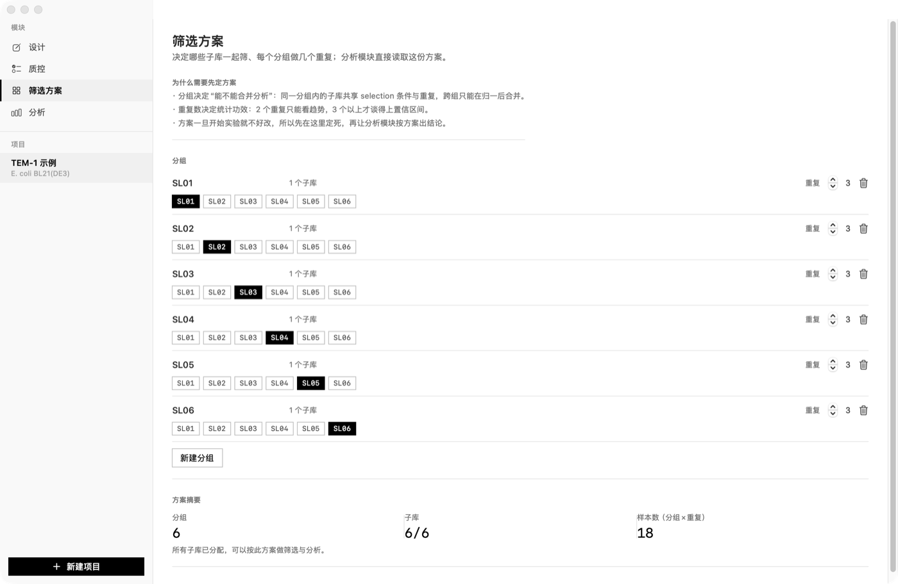

## 筛选分析的两个视角

- **逐组解析（Per-group）**：只分析单个分组及其重复，结论明确限定在该分组的筛选范围内，不跨组比较。
- **跨组归一（Joint）**：每组先按本组 WT 对照的平均 fold-change 归一（基线平移），再按逆方差合并成一个蛋白层面的数据集；以同义变体为 null 计算 z / p / BH-FDR（同义不足 3 个时用中位 SE 兜底）；同时给出组间相关矩阵（共享变体的 Pearson r）。
- 结构映射（可选）：导入 **PDB 或 mmCIF**，按 CA 骨架做 Catmull-Rom 平滑（ribbon 观感）并把 effect 映射到结构上；可勾选要映射的链；**自动识别完全相同的链**（同源二聚体）并默认只选每组一条；配色支持 **灰阶 / 蓝红 / 热度** 三套；可 **导出 PNG**（1600×1200）用于组会或论文图；逐组解析里也能看当前分组的结构映射。

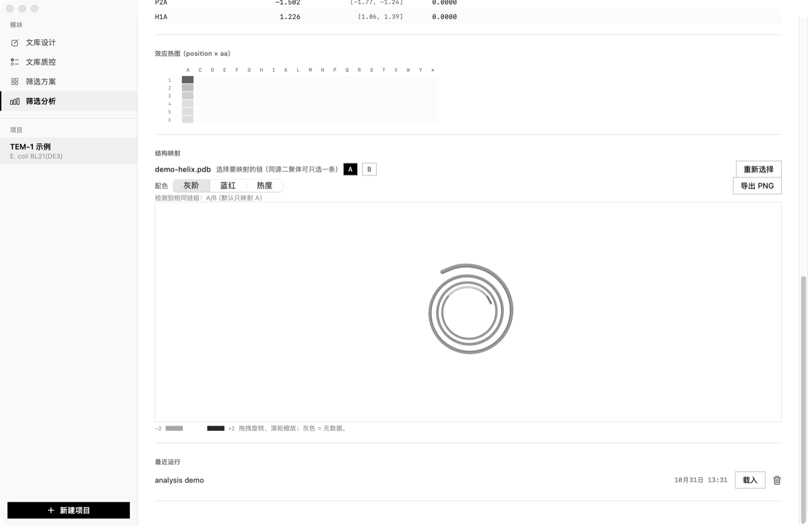

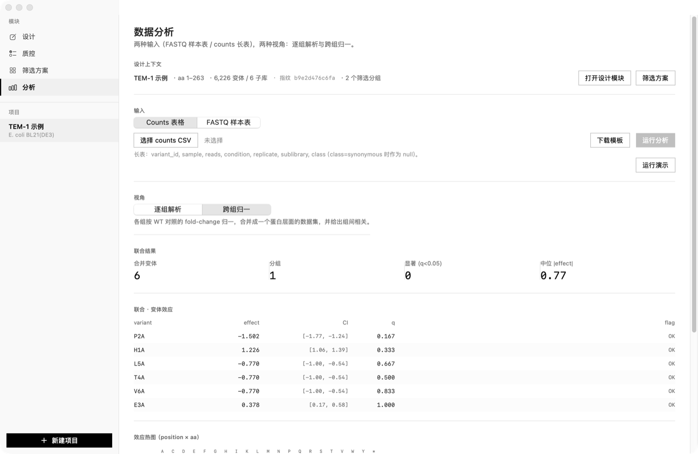

## 数据存储与迁移

- 默认根目录：`~/Library/Application Support/DMSFoundry`（projects、runs.sqlite、presets.json）。
- 设置 → 默认值 → **数据存储** 可改到自定义目录；迁移前会弹确认，迁移时主界面被进度页覆盖（只剩进度条与当前文件名），完成后自动重启。
- 迁移为复制 → 校验 → 删除旧数据；目标目录已有同名数据会拒绝，避免覆盖。

## 版本号

版本集中在 `mac/VERSION` 与 `mac/BUILD`，`build.sh` 自动注入 Info.plist；每次迭代同步递增（当前 **0.4.5 / 9**）。

## 设计与质控/分析的绑定

- QC 与分析页顶部显示**设计上下文**：项目、目标区间、酶与步长、变体/子库数、**设计指纹**（SHA-256 前 6 字节），并提供「打开设计模块」。
- 每次 QC/分析运行都会把指纹写进 `runs.sqlite`；载入旧结果时如果指纹与当前设计不一致，页面会明确提示「结果基于旧设计，请重跑」。
- 设计模块标题栏显示最近一次 QC 结论徽标（PASS/WARN/FAIL · 日期），点击直接跳到质控模块。
- 样本表里的 `index5/index3` 会与设计分配的 index 对自动核对，不一致给出警告；同时校验 index 组合唯一、长度 6–12、只含 ACGT、两两汉明距离 ≥3。

## 质控 / 分析模块界面（M2 / M4）

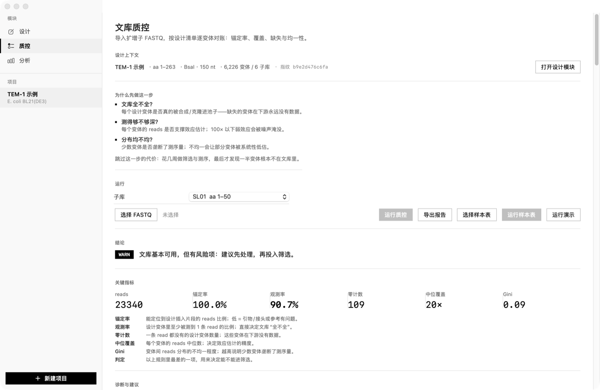
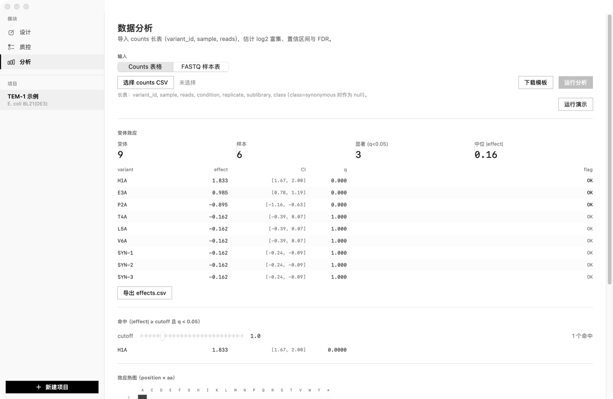
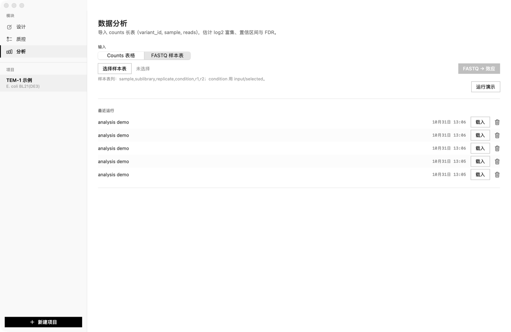

- **质控**：单文件或**样本表**（`sample,sublibrary,replicate,condition,r1,r2`，支持**双端 overlap merge**）；报告按“动机 → 结论 → 诊断与建议”组织：
  - 「为什么先做这一步」：文档全不全 / 测得够不够深 / 分布均不均，以及跳过的代价；
  - 结论徽标 + 一句话判定；关键指标附「意味着什么」；
  - 诊断与建议：规则化给出阻断/警告、原因与下一步（如需要补测到约 N 条 reads、导出缺失清单）；
  - 明细（子库、变体、样本）折叠在「明细数据」，支持批量样本与子库汇总。
- **分析（两种输入）**：
  1. **FASTQ 样本表**：选样本表 → 直接对本样本做锚定计数 → 自动配对 input/selected → 出效应；
  2. **counts 长表**：`variant_id,sample,reads[,condition,replicate,sublibrary,class]`。
- 输出：effect / 95% CI / q 表（按 |effect| 排序）、**命中 calling**（cutoff 可调，|effect|≥cutoff 且 q<0.05）、**position × aa 热图**、导出 `effects.csv`。
- **运行持久化**：QC 与分析结果写入 SQLite（`~/Library/Application Support/DMSFoundry/runs.sqlite`），可在「最近运行」里载入或删除。
- 「运行演示」不需要真实数据即可看完整流程。
- 双端：先做 overlap merge（R2 反向互补，≥20 nt 重叠、≤10% 错配），失败时回退单端。
- 边界：QC 单文件模式一次一个子库（样本表模式可跨子库批量）；读长需覆盖插入片段；文库大小用锚定 reads（含 WT）。

## 质控 / 分析引擎（M1 / M3）

两个纯 Swift 模块，无外部二进制依赖，接口在 `DMSEngine`：

- `FastqReader` / `GZip`：`FileByteStream` 与 `GZipByteStream`（管道调 `/usr/bin/gzip -dc`）分块读，`LineReader` 按行切分；FASTQ 单条解析。
- `QCCounter.count(fastqURL:design:)`：用 5′ 锚点（或 reference 前 20 nt）定位插入片段，支持反向互补；逐密码子比对，单点变体查表计数；其余归入错误谱（WT / 未知单点 / 多点 / 未锚定）。
- `QCReport`：变体级 `observed / flag(OK/LOW/ZERO)`、中位覆盖、Gini、每子库指标、判定（pass/warn/fail），导出 `qc_report.csv`。
- `AnalysisEngine.run(...)`：按 (sublibrary, replicate) 配对 input/selected，`log2((c+p)/N)` + delta 法 SE，逆方差加权合并，同义变体做 null（退化为常数时用自身 SE），BH-FDR；输出 effect/CI/z/q/flag。

自检（合成数据）：

```bash
DMS_QC_SELFTEST=1 "DMS Foundry.app/Contents/MacOS/DMSFoundry"
# qc_reads=120 anchored=120 designed=4 observed=2 zero=2
# qc_median=20.0 gini=0.500 verdict=fail wildtype=40

DMS_ANALYSIS_SELFTEST=1 "DMS Foundry.app/Contents/MacOS/DMSFoundry"
# effect V1: 1.995 ci=[1.812,2.177] q=0.0000 reps=3
# effect V2: 0.000 ci=[-0.230,0.230] q=0.4901 reps=3
```

规格与阈值依据见 [qc-analysis-spec.md](docs/qc-analysis-spec.md)。下一步是 M2/M4 的界面：导入 run + 样本表、QC 报告页、变体效应表与热图。

## 设置与预设

- **⌘, 打开设置**，两个页签：
  - **默认值**：新项目自动继承的宿主、文库参数（同义/稀有密码子/终止/WT、密码子策略与表、子库步长）、组装方式与酶、质检项默认数量；可「保存为默认值」或「恢复出厂默认」。
  - **命名预设**：把当前项目参数存成命名预设（只含参数，不含质粒与突变目标），可「应用到当前项目」或删除。
- 项目内第 3 步右上角有「预设」菜单：应用预设、保存当前为预设、用当前参数更新新项目默认值。
- 存储：默认值在 UserDefaults，命名预设在 `~/Library/Application Support/DMSFoundry/presets.json`。
- 已验证：默认值 + 命名预设跨进程持久化（`DMS_PRESET_SELFTEST=1`），新项目继承宿主与步长。

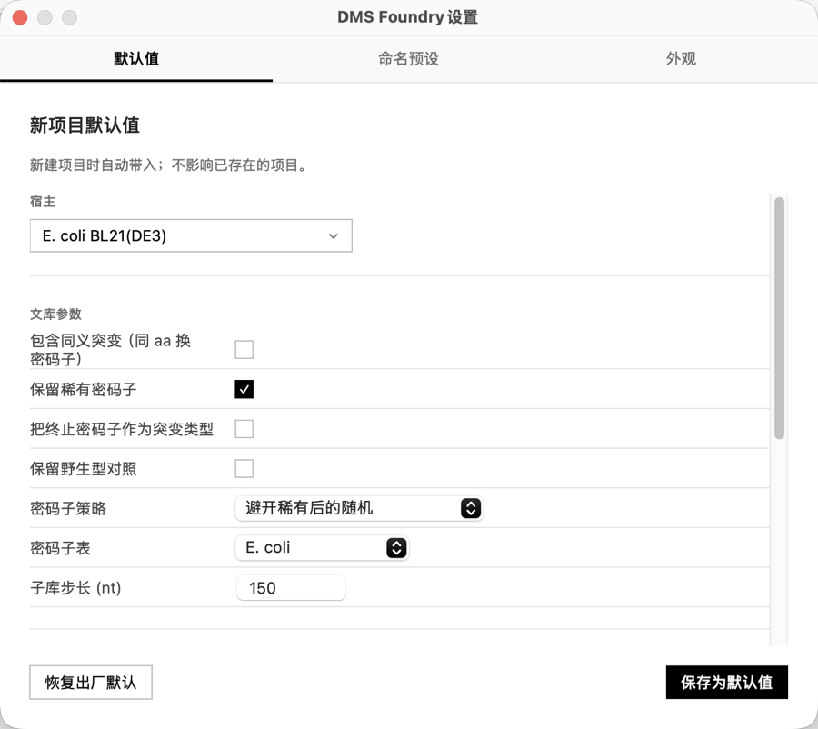
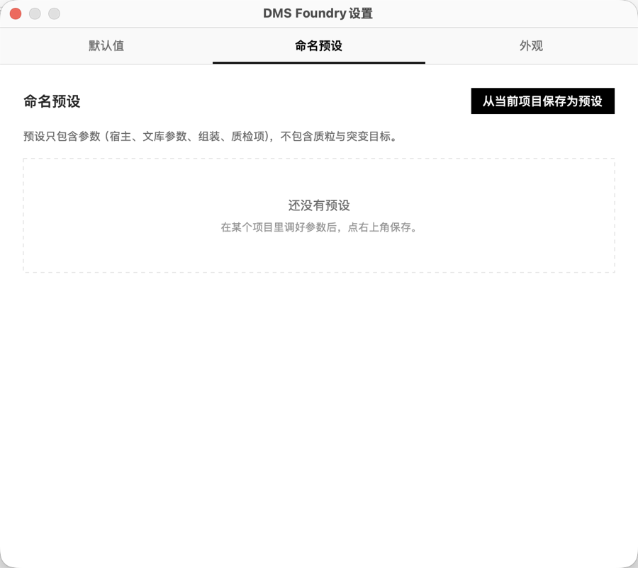
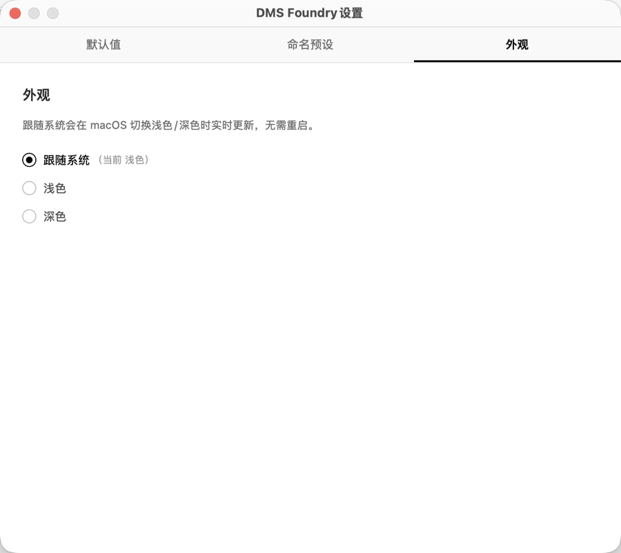

## 双语

- 菜单「DMS Foundry → Language」在简体中文 / English 之间切换，偏好存在 UserDefaults，重启保持。
- 导航、步骤、表单、按钮、说明、状态行、错误提示、动态消息（如 "Sample loaded: pTEM1_CDS · 792 bp"）均已双语；项目名等用户数据保持原文。

## 截图

**文库设计**

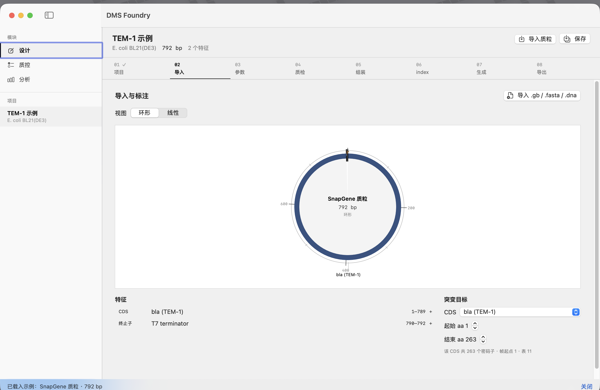
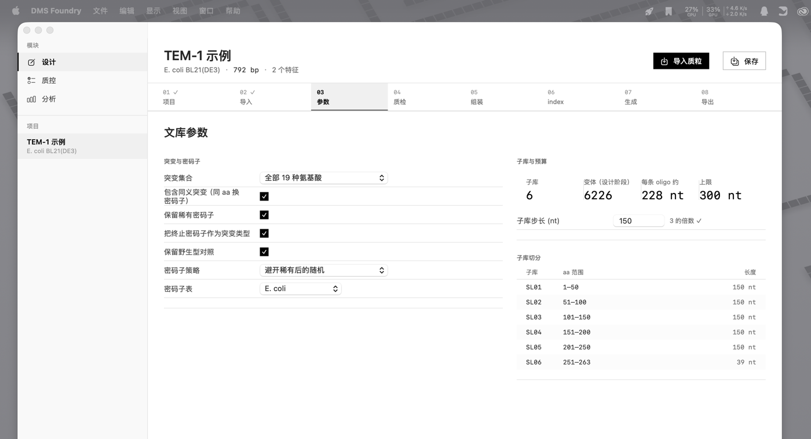
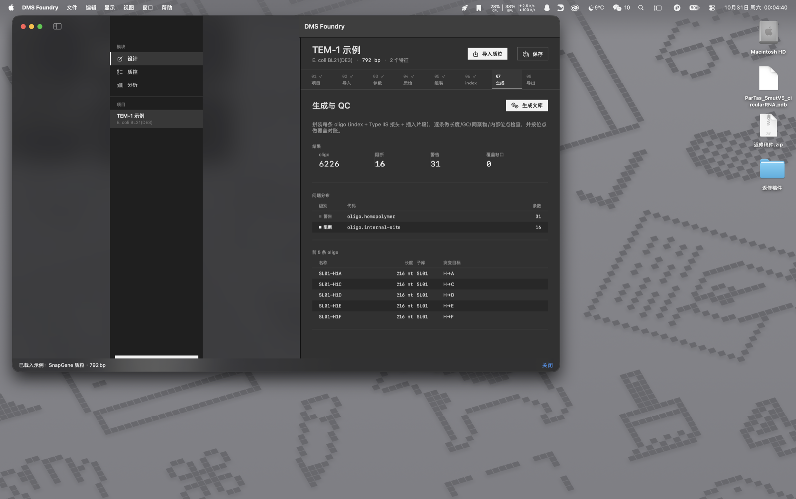
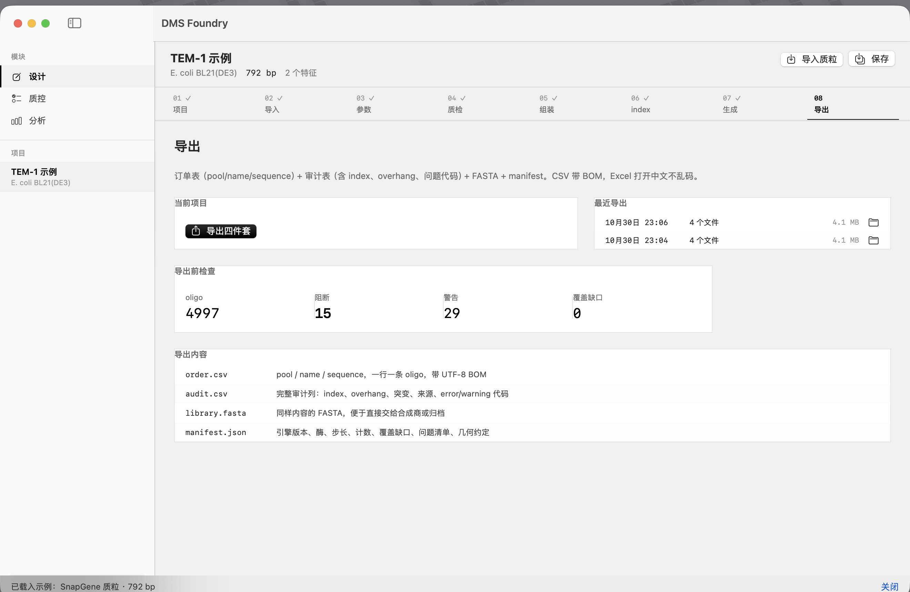

**文库质控**


**筛选方案**


**筛选分析**


**设置**


## 数据来源与许可

代码以 MIT 许可发布。内置数据表来自公开来源，重分发时请保留出处：

- **密码子频率**：Kazusa Codon Usage Database（E. coli W3110 / human），学术使用请引用该数据库。
- **酶识别位点与切割几何**：REBASE 各酶页面。
- **overhang 保真度**：Potapov et al. 2018（ACS Synth Biol）方法官方分析仓库的实测数据；引用原论文。
- **index 冻结表**：本项目生成（seed 20261102），可自由使用。
- **示例质粒**：TEM-1（公共序列）。

## 贡献

欢迎 issue / PR。开发用 `swift test` 跑引擎测试；提交前请确认 `CONFIG=debug ./build.sh` 与 `swift test` 都通过。

## 当前进度

| 里程碑 | 状态 |
| --- | --- |
| M1 骨架：项目、GenBank/FASTA 解析、线性质粒轨道、坐标换算 | ✅ |
| M2 参数：密码子表、单点枚举、子库切分、长度预算 | ✅ |
| M3 质检项 + Golden Gate / Gibson + overhang 打分 | ✅ |
| M4 index 匹配、oligo 拼装、全长 QC、导出 | ✅ |
| M5 双语 + 占位模块 | ✅（界面与动态提示均已双语；项目名等用户数据不翻译） |
| UI 精修 | ✅ 黑白化、去框感、自定义侧栏（无 split view 缝隙）、步骤条进度、环形图、空状态、切换动效 |
| 深色模式 | ✅ 跟随系统（实时切换，无需重启）/ 浅色 / 深色；入口：视图 → 外观、设置 → 外观 |
| 设置与预设 | ✅ 新项目默认值 + 命名预设 + 数据存储位置/迁移 + fastp 参数 |
| 筛选方案 | ✅ 分组/子库分配/重复数，默认一子库一分组，与筛选分析互通 |
| 筛选分析双视角 | ✅ 逐组解析（组内结论）+ 跨组归一（WT 基线、合并、相关矩阵） |
| 结构映射 | ✅ PDB CA 骨架按效应着色，可选链（多链/同源二聚体） |
| 质控引擎（M1） | ✅ FASTQ 流式（含 .gz）、锚点定位、变体计数、对账、指标与 CSV |
| 质控界面（M2） | ✅ 单文件/样本表、双端、总览+子库+变体表、导出报告、运行持久化 |
| 分析引擎（M3） | ✅ CPM 归一、log2FC ± CI、replicate 逆方差合并、同义 null、BH-FDR |
| 分析界面（M4） | ✅ 两种输入（FASTQ 样本表 / counts 长表）、效应表、命中 calling、热图、导出与持久化 |
| M6 分发与更新 | ✅ 半自动链路（检查/下载/双校验/Finder 显示）；Sparkle 自动安装待 Developer ID |

M4 实际跑通的结果（TEM-1 示例，BsaI，150 nt 步长）：
- 生成 **4,997 条 oligo**，每条 216 nt；
- 逐条 QC：**15 条阻断**（全部是突变自身造出的 BsaI 位点 `oligo.internal-site`）、**29 条警告**（同聚物 ≥6）；
- 覆盖对账：**0 个位点缺口**；
- 导出四件套已验证：`order.csv` 带 BOM、`audit.csv` 17 列、`library.fasta`、`manifest.json`（含计数、覆盖缺口、问题代码、几何约定）。

已实现的行为：导入 `.gb` / `.fasta` → 轨道可视化 → 选 CDS 与 aa 区间 → 设参数 → 四类质检项 → 组装方式与子库接口打分 → 保存到 `~/Library/Application Support/DMSFoundry/projects/`。

组装判定口径（M3）：
- 子库边界按密码子对齐搜索，**只允许缩短**，保证覆盖连续、无缺口、总长不变；
- overhang 由 WT 边界序列决定，不可自由挑选；按 Potapov 实测保真度打分；
- 保真度 **< 0.60 → 阻断**，0.60–0.80 → 警告，≥ 0.80 → 通过；回文 overhang 一律阻断；
- 内部 Type IIS 位点按**整条片段**扫描（后续会扩到整条 oligo）；Refine 只做同义替换预览，应用留给 M4 的序列生成。

## 分发与更新

- `mac/release.sh <version> <build> [notes_zh] [notes_en]`：构建 → zip → SHA-256 → Ed25519 签名 → 生成 `server/<channel>/manifest.json`。
- 应用内「检查更新…」（⌘U）：填服务器地址 → 检查 → 下载 → **SHA-256 + Ed25519 双校验** → 落盘并在 Finder 显示。
- ad-hoc 阶段不做就地替换（Gatekeeper 会拦），手动拖入「应用程序」；拿到 Developer ID + 公证后再接 Sparkle 自动安装。
- 清单格式、密钥管理、上传步骤见 [server/README.md](server/README.md)。
- 已验证：本地 HTTPS/HTTP 服务器上的 0.2.1（build 3）能被 0.2.0（build 2）检出、下载、验签；篡改 zip → SHA-256 拒绝，篡改签名 → Ed25519 拒绝。


## 宿主支持

宿主按组分类，选中后自动切换密码子表（E. coli 菌株 → E. coli 表，哺乳动物细胞 → 人表）：

- **克隆菌株（E. coli）**：DH5α、TOP10、DH10B、NEB 5-alpha、JM109、Stbl3、XL1-Blue、Mach1-T1、AG1、HB101、SCS110 (dam−/dcm−)、GM2163 (dam−)
- **表达菌株（E. coli）**：BL21(DE3)、BL21(DE3)pLysS、BL21(DE3)Star、Rosetta(DE3)、Lemo21(DE3)、Origami B(DE3)、SHuffle T7、C41(DE3)、C43(DE3)、ArcticExpress
- **酵母**：BY4741、INVSc1、P. pastoris GS115 / X-33
- **哺乳动物**：Expi293F、HEK293T、CHO-S、CHO-K1、HeLa、NIH/3T3
- **无细胞**：PURExpress、无细胞体系；另有「其他（自定义）」

## 视觉规范（黑白）

- **只有黑白灰**：全局 `tint(.black)`；选中态 = 黑 6% 底 + 2pt 左侧竖条；不用系统 accent 蓝。
- **布局**：内容栏最大 1120pt 居中，统一左基线；间距只用 8/12/16/24/32/40 六档。
- **步骤条**：序号 + 标题；当前步加粗 + 2pt 黑色下划线，已完成步打勾，悬停浅灰。
- **表格**：30pt 行高、隔行 2% 底、数值右对齐、表头小号灰字。
- **面板**：白底 + 1pt 分隔线，无圆角、无阴影（严格直角）。
- **动效**：步骤/模块切换 160–180ms ease-out 淡入 + 轻微位移；数字用 `numericText` 过渡；仅此而已，不做弹跳。
- **空状态**：给下一步动作 + 最近记录，不留大片空白。

## 模块流水线

**文库设计 → 文库质控 → 筛选方案 → 筛选分析**

- **筛选方案**：决定哪些子库一起筛、每个分组几个重复。默认「一个子库一个分组」，也可以在分组里合并多个子库或让同一子库出现在多个分组（不同筛选条件）；空分组会提示并可一键清理。
- **筛选分析**读取这份方案，按分组过滤样本；方案改动后重跑即可。


## 筛选分析的两个视角

- **逐组解析（Per-group）**：只分析单个分组及其重复，结论明确限定在该分组的筛选范围内，不跨组比较。
- **跨组归一（Joint）**：每组先按本组 WT 对照的平均 fold-change 归一（基线平移），再按逆方差合并成一个蛋白层面的数据集；以同义变体为 null 计算 z / p / BH-FDR（同义不足 3 个时用中位 SE 兜底）；同时给出组间相关矩阵（共享变体的 Pearson r）。
- 结构映射（可选）：导入 **PDB 或 mmCIF**，按 CA 骨架做 Catmull-Rom 平滑（ribbon 观感）并把 effect 映射到结构上；可勾选要映射的链；**自动识别完全相同的链**（同源二聚体）并默认只选每组一条；配色支持 **灰阶 / 蓝红 / 热度** 三套；可 **导出 PNG**（1600×1200）用于组会或论文图；逐组解析里也能看当前分组的结构映射。


## 数据存储与迁移

- 默认根目录：`~/Library/Application Support/DMSFoundry`（projects、runs.sqlite、presets.json）。
- 设置 → 默认值 → **数据存储** 可改到自定义目录；迁移前会弹确认，迁移时主界面被进度页覆盖（只剩进度条与当前文件名），完成后自动重启。
- 迁移为复制 → 校验 → 删除旧数据；目标目录已有同名数据会拒绝，避免覆盖。

## 版本号

版本集中在 `mac/VERSION` 与 `mac/BUILD`，`build.sh` 自动注入 Info.plist；每次迭代同步递增（当前 **0.4.5 / 9**）。

## 设计与质控/分析的绑定

- QC 与分析页顶部显示**设计上下文**：项目、目标区间、酶与步长、变体/子库数、**设计指纹**（SHA-256 前 6 字节），并提供「打开设计模块」。
- 每次 QC/分析运行都会把指纹写进 `runs.sqlite`；载入旧结果时如果指纹与当前设计不一致，页面会明确提示「结果基于旧设计，请重跑」。
- 设计模块标题栏显示最近一次 QC 结论徽标（PASS/WARN/FAIL · 日期），点击直接跳到质控模块。
- 样本表里的 `index5/index3` 会与设计分配的 index 对自动核对，不一致给出警告；同时校验 index 组合唯一、长度 6–12、只含 ACGT、两两汉明距离 ≥3。

## 质控 / 分析模块界面（M2 / M4）


- **质控**：单文件或**样本表**（`sample,sublibrary,replicate,condition,r1,r2`，支持**双端 overlap merge**）；报告按“动机 → 结论 → 诊断与建议”组织：
  - 「为什么先做这一步」：文档全不全 / 测得够不够深 / 分布均不均，以及跳过的代价；
  - 结论徽标 + 一句话判定；关键指标附「意味着什么」；
  - 诊断与建议：规则化给出阻断/警告、原因与下一步（如需要补测到约 N 条 reads、导出缺失清单）；
  - 明细（子库、变体、样本）折叠在「明细数据」，支持批量样本与子库汇总。
- **分析（两种输入）**：
  1. **FASTQ 样本表**：选样本表 → 直接对本样本做锚定计数 → 自动配对 input/selected → 出效应；
  2. **counts 长表**：`variant_id,sample,reads[,condition,replicate,sublibrary,class]`。
- 输出：effect / 95% CI / q 表（按 |effect| 排序）、**命中 calling**（cutoff 可调，|effect|≥cutoff 且 q<0.05）、**position × aa 热图**、导出 `effects.csv`。
- **运行持久化**：QC 与分析结果写入 SQLite（`~/Library/Application Support/DMSFoundry/runs.sqlite`），可在「最近运行」里载入或删除。
- 「运行演示」不需要真实数据即可看完整流程。
- 双端：先做 overlap merge（R2 反向互补，≥20 nt 重叠、≤10% 错配），失败时回退单端。
- 边界：QC 单文件模式一次一个子库（样本表模式可跨子库批量）；读长需覆盖插入片段；文库大小用锚定 reads（含 WT）。

## 质控 / 分析引擎（M1 / M3）

两个纯 Swift 模块，无外部二进制依赖，接口在 `DMSEngine`：

- `FastqReader` / `GZip`：`FileByteStream` 与 `GZipByteStream`（管道调 `/usr/bin/gzip -dc`）分块读，`LineReader` 按行切分；FASTQ 单条解析。
- `QCCounter.count(fastqURL:design:)`：用 5′ 锚点（或 reference 前 20 nt）定位插入片段，支持反向互补；逐密码子比对，单点变体查表计数；其余归入错误谱（WT / 未知单点 / 多点 / 未锚定）。
- `QCReport`：变体级 `observed / flag(OK/LOW/ZERO)`、中位覆盖、Gini、每子库指标、判定（pass/warn/fail），导出 `qc_report.csv`。
- `AnalysisEngine.run(...)`：按 (sublibrary, replicate) 配对 input/selected，`log2((c+p)/N)` + delta 法 SE，逆方差加权合并，同义变体做 null（退化为常数时用自身 SE），BH-FDR；输出 effect/CI/z/q/flag。

自检（合成数据）：

```bash
DMS_QC_SELFTEST=1 "DMS Foundry.app/Contents/MacOS/DMSFoundry"
# qc_reads=120 anchored=120 designed=4 observed=2 zero=2
# qc_median=20.0 gini=0.500 verdict=fail wildtype=40

DMS_ANALYSIS_SELFTEST=1 "DMS Foundry.app/Contents/MacOS/DMSFoundry"
# effect V1: 1.995 ci=[1.812,2.177] q=0.0000 reps=3
# effect V2: 0.000 ci=[-0.230,0.230] q=0.4901 reps=3
```

规格与阈值依据见 [qc-analysis-spec.md](docs/qc-analysis-spec.md)。下一步是 M2/M4 的界面：导入 run + 样本表、QC 报告页、变体效应表与热图。

## 设置与预设

- **⌘, 打开设置**，两个页签：
  - **默认值**：新项目自动继承的宿主、文库参数（同义/稀有密码子/终止/WT、密码子策略与表、子库步长）、组装方式与酶、质检项默认数量；可「保存为默认值」或「恢复出厂默认」。
  - **命名预设**：把当前项目参数存成命名预设（只含参数，不含质粒与突变目标），可「应用到当前项目」或删除。
- 项目内第 3 步右上角有「预设」菜单：应用预设、保存当前为预设、用当前参数更新新项目默认值。
- 存储：默认值在 UserDefaults，命名预设在 `~/Library/Application Support/DMSFoundry/presets.json`。
- 已验证：默认值 + 命名预设跨进程持久化（`DMS_PRESET_SELFTEST=1`），新项目继承宿主与步长。


## 双语

- 菜单「DMS Foundry → Language」在简体中文 / English 之间切换，偏好存在 UserDefaults，重启保持。
- 导航、步骤、表单、按钮、说明、状态行、错误提示、动态消息（如 "Sample loaded: pTEM1_CDS · 792 bp"）均已双语；项目名等用户数据保持原文。

## 数据来源（全部随包冻结，不联网）

| 文件 | 内容 | 来源 | 状态 |
| --- | --- | --- | --- |
| `codons_ecoli.json` | E. coli W3110 密码子频率（1,372,057 codons） | [Kazusa](http://www.kazusa.or.jp/codon/cgi-bin/showcodon.cgi?species=316407&aa=1&style=N) | 实测，sum=1000.0 |
| `codons_human.json` | Human 密码子频率（40,662,582 codons） | [Kazusa](http://www.kazusa.or.jp/codon/cgi-bin/showcodon.cgi?species=9606&aa=1&style=N) | 实测，sum=1000.2 |
| `enzymes.json` | BsaI/BsmBI/BbsI/SapI/BspQI/AarI 几何 | REBASE 各酶页面 | 实测，cut 偏移自洽 |
| `overhangs_t4.json` | 256 个 4-nt overhang 保真度 | Potapov et al. 2018 方法官方分析仓库（SRA PRJNA894239） | **实测**，fidelity 0.37–0.98 |
| `indices_1024.json` | 1024 条 20 nt 子库 index | 本地生成（seed 20261102） | 全约束通过，min Hamming 6 |
| `tem1_cds.gb` | TEM-1 成熟 CDS 示例（792 bp） | UniProt P62593，E. coli 最优密码子回译 | 真实序列 |

注意：
- 密码子表用 **W3110**（K-12 亚株）而非 Kazusa 里 14 条 CDS 的 K-12 字面条目；理由写在 JSON 的 `notes`。
- overhang 数据来自论文方法的官方重测仓库，不是论文 SI 转录；反应条件未记录，JSON 里标为 NOT VERIFIED。
- index 冻结表的 Tm 下限 55 °C 导致 GC 被推到 0.50–0.60（上半窗），后续可考虑放宽 Tm 或改盐条件。

## `.dna` 解析范围

- 支持：文档头校验、DNA 块（拓扑/序列）、features XML（name/type/directionality/多 Segment/color）。
- 忽略：primers、notes、history、alignment 等其他块。
- 坐标按 Segment `range` 的 min/max 转成 0-based 半开；`directionality=2` 记为反向链。
- 反向测试：伪造 `.dna` 头部 → 抛错；内置 `tem1_cds.dna` 示例可 `⌘D` 直接载入。

## 已知问题 / 下一步

- 质检项、组装、index 匹配、导出尚未接入界面（步骤 4–8 现为占位）。
- 语言目前只有中文；英文待 M5。
- 目前只有线性质粒图，环形待后续。
- 自动更新待 M6（需要 Developer ID + 公证才能真正就地安装）。
